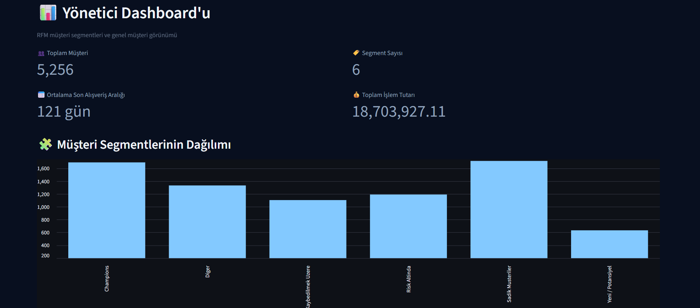
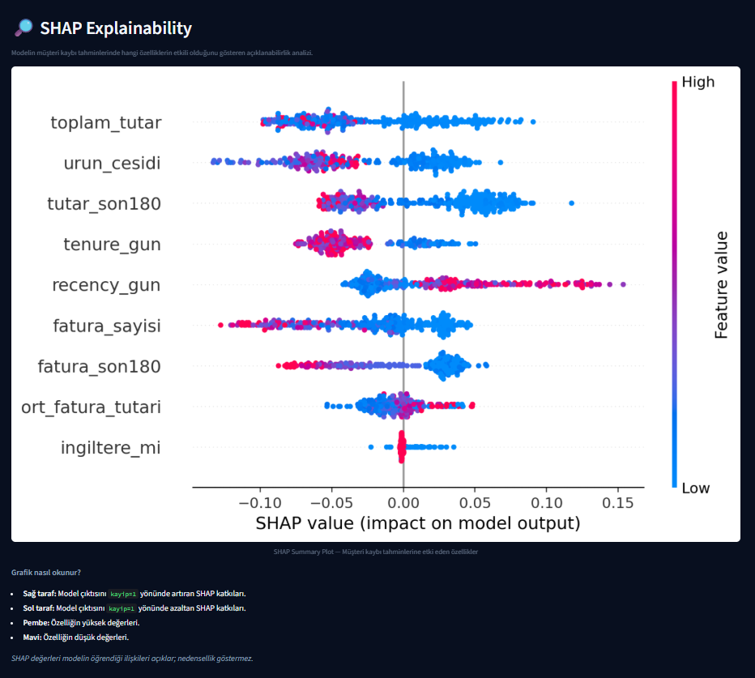
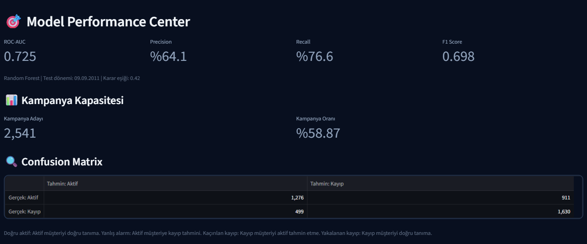
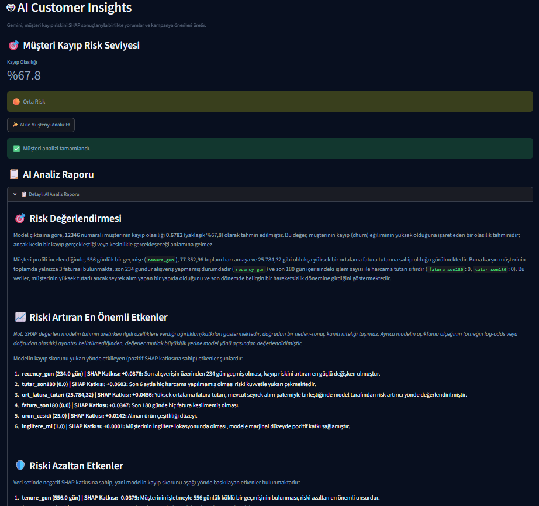

## 🚀 Canlı Demo

Uygulamayı buradan deneyebilirsiniz:

**[Retail Intelligence — Canlı Uygulama](https://retail-customer-analytics.streamlit.app/)**

Müşteri segmentasyonu, kayıp riski analizi, SHAP açıklamaları ve Gemini AI destekli müşteri içgörülerini keşfedin.

# 🛍️ Retail Intelligence — Yapay Zekâ Destekli Müşteri Analitiği

Perakende sektöründe müşteri segmentasyonu, müşteri kaybı (churn) riski analizi ve yapay zekâ destekli müşteri içgörüleri sunan interaktif bir veri analitiği uygulaması.

## 🎯 Projenin Amacı

Müşteri davranışlarını analiz ederek işletmelerin müşteri kaybı riskini değerlendirmesine, müşteri gruplarını tanımasına ve veriye dayalı pazarlama stratejileri geliştirmesine yardımcı olmak.

## ✨ Öne Çıkan Özellikler

- **Yönetici Dashboard'u:** Genel müşteri göstergeleri ve segment dağılımlarının görüntülenmesi.
- **RFM Müşteri Segmentasyonu:** Müşterilerin alışveriş davranışlarına göre gruplandırılması.
- **Churn Analizi:** Müşteri kaybı riski ve model performansının incelenmesi.
- **Model Performans Merkezi:** Makine öğrenmesi modelinin performans metriklerinin değerlendirilmesi.
- **SHAP ile Açıklanabilir Yapay Zekâ:** Model tahminlerini etkileyen özelliklerin ve müşteri bazındaki katkıların incelenmesi.
- **Gemini AI ile Müşteri İçgörüleri:** Müşteriye özel risk değerlendirmesi ve geri kazanım kampanyası önerileri.

## 🧰 Kullanılan Teknolojiler

- Python
- Streamlit
- Pandas
- Makine öğrenmesi
- SHAP
- Google Gemini API

## 🖥️ Uygulamayı Çalıştırma

### 1. Depoyu klonlayın

```bash
git clone https://github.com/bilgehanbkts/retail-intelligence.git
cd retail-intelligence
```

GitHub kullanıcı adınızdaki boşlukları kaldırarak doğru depo adresini kullanın.

### 2. Sanal ortam oluşturun

```bash
python -m venv .venv
```

Windows:

```bash
.venv\Scripts\activate
```

### 3. Gerekli paketleri yükleyin

Projede kullanılan paketleri `requirements.txt` dosyası üzerinden yükleyin:

```bash
pip install -r requirements.txt
```

### 4. Gemini API anahtarını yapılandırın

`.streamlit/secrets.toml` dosyasını yerel ortamınızda oluşturun:

```toml
GEMINI_API_KEY = "API_ANAHTARINIZ"
```

**Güvenlik:** Gerçek API anahtarınızı GitHub'a yüklemeyin.

### 5. Uygulamayı başlatın

```bash
python -m streamlit run app2.py
```

## 📊 Analitik Yaklaşım

Proje; müşteri segmentasyonu, müşteri kaybı riskinin değerlendirilmesi ve model açıklanabilirliğini tek bir arayüzde birleştirir. SHAP analizleri model tahminlerine katkıda bulunan özellikleri anlamaya yardımcı olur; bu katkılar tek başına nedensellik göstermez.

## 🔐 Veri ve Güvenlik

- API anahtarları ve gizli bilgiler depoya eklenmemelidir.
- Gerçek müşteri verileri paylaşılmadan önce anonimleştirme ve erişim kontrolleri değerlendirilmelidir.
- Kurulum için gerekli veri dosyaları ve bağımlılıklar ayrıca sağlanmalıdır.

## 👩‍💻 Proje Hakkında

Bu proje; veri analitiği, müşteri segmentasyonu, makine öğrenmesi, açıklanabilir yapay zekâ ve iş odaklı karar destek uygulamalarını bir araya getiren bir portföy çalışmasıdır.

## 📸 Uygulama Ekran Görüntüleri

### Yönetici Dashboard'u


### SHAP Analizi


### Model Performansı


### Gemini AI Müşteri Analizi

